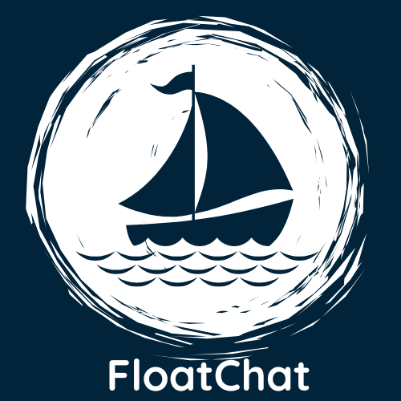

# 🌊 FloatChat - AI-Powered Ocean Data Explorer

<div align="center">



**Where Data Meets the Deep — Intelligent Ocean Data Analysis Made Simple**

[](https://python.org)
[](https://streamlit.io)
[](https://flask.palletsprojects.com)
[](https://postgresql.org)
[](https://huggingface.co/sentence-transformers)
[](LICENSE)

</div>

---

## What is FloatChat?

FloatChat is an AI-powered conversational interface for ARGO oceanographic float data. It lets you query ocean profiles (temperature, salinity, pressure) using natural language, visualise results interactively, and get plain-English explanations powered by Google Gemini.

---

## Architecture Overview

```
Official Argo GDAC (Ifremer ERDDAP)
       │  (on-demand fetch / tabledap CSV)
       ▼
   api/query.py ──► api/query_parser.py (deterministic extraction)
       │
       ├──► api/argo_cache.py (PostgreSQL caching / idempotent upserts)
       │           ├── profiles (wmo_id, juld, lat, lon, source, source_url)
       │           └── profile_levels (pres, temp, psal, QC flags)
       │
       └──► Google Gemini (models/gemini-2.5-flash) ──► Grounded Explanation
                                                              │
User query ──► Streamlit frontend (frontend/front.py) ◄───────┘
                     (Source badges: 🟢 Live | 🔵 Cached | ⚫ Local | ⚠️ Error)
```

---

## Prerequisites

| Requirement | Notes |
|---|---|
| Python **3.11** | Must match the `.venv` interpreter |
| PostgreSQL **13+** (tested on 18.6) | Running locally on port 5432 |
| Google Gemini API key | `models/gemini-1.5-flash`; chatbot degrades gracefully without it |
| Virtual environment `.venv` | Already created in the repo root |

---

## Environment Variables

Create a file called **`.env`** in the **repository root** (or copy `.env.example`):

```bash
# PostgreSQL Database Configuration
HOST_NAME=localhost
DATABASE_NAME=floatchatai
USER_NAME=postgres
PASSWORD=your_db_password
PORT=5432

# Google Gemini API Key
GOOGLE_API_KEY=your_gemini_api_key
GEMINI_MODEL=models/gemini-2.5-flash

# Live Argo Integration Settings (Optional defaults shown)
ARGO_LIVE_FETCH=true
ARGO_LOCAL_FALLBACK=true
ARGO_MAX_PROFILES=20
ARGO_ERDDAP_TIMEOUT=30
ARGO_CACHE_TTL_HOURS=24
FLOATCHAT_TOP_K=3
FLOATCHAT_RADIUS_METERS=50000
```

> [!IMPORTANT]
> All secrets are loaded exclusively from the root `.env`. Neither `api/query.py` nor `ingestion/main.py` hard-code credentials. If any of the five required variables are missing the API will refuse to start and print which ones are absent (never their values).

---

## Local Setup (Windows / PowerShell)

### 1 — Clone and activate the virtual environment

```powershell
cd C:\PROJECTSPACE\WorkSpace\floatchat
.\.venv\Scripts\Activate.ps1
```

### 2 — Verify installed packages

```powershell
# All dependencies for API + frontend are already installed in .venv
.venv\Scripts\python.exe -c "import flask, psycopg2, streamlit, sentence_transformers; print('OK')"
```

If a package is missing, install from the relevant requirements file:

```powershell
.venv\Scripts\pip.exe install -r api\requirements.txt
.venv\Scripts\pip.exe install -r frontend\requirements.txt
```

### 3 — Verify the database

```powershell
.venv\Scripts\python.exe -c "
import os, psycopg2
from dotenv import load_dotenv
load_dotenv('.env')
conn = psycopg2.connect(host=os.getenv('HOST_NAME'), database=os.getenv('DATABASE_NAME'),
                        user=os.getenv('USER_NAME'), password=os.getenv('PASSWORD'))
cur = conn.cursor()
cur.execute('SELECT COUNT(*) FROM profiles')
print('profiles:', cur.fetchone()[0])
cur.execute('SELECT COUNT(*) FROM profile_levels')
print('profile_levels:', cur.fetchone()[0])
conn.close()
"
```

Expected output: `profiles: 75`, `profile_levels: 51364`

---

## Running the Application

Open **two separate PowerShell terminals**, both in the repo root:

### Terminal 1 — Flask API (port 5000)

```powershell
cd C:\PROJECTSPACE\WorkSpace\floatchat
.\.venv\Scripts\Activate.ps1
.venv\Scripts\flask.exe --app api\query run --no-reload --host 127.0.0.1 --port 5000
```

The API is ready when you see:
```
* Running on http://127.0.0.1:5000
```

### Terminal 2 — Streamlit Frontend (port 8501)

```powershell
cd C:\PROJECTSPACE\WorkSpace\floatchat
.\.venv\Scripts\Activate.ps1
.venv\Scripts\streamlit.exe run frontend\front.py
```

Then open **http://localhost:8501** in your browser.

> [!TIP]
> The frontend can also be run from any directory — all internal paths (`dummy.db`, etc.) are resolved relative to the source file location.

---

## Data Ingestion

> [!CAUTION]
> **Do NOT re-run ingestion against an already-populated database.** The script will detect existing rows and abort with an error rather than create duplicates. If you need to reimport, first truncate the tables and reset sequences manually in psql, then get approval.

To ingest new NetCDF files into a fresh database:

```powershell
# Place .nc files in the data/ directory first
.venv\Scripts\python.exe ingestion\main.py
```

The script:
- Loads credentials from the root `.env`
- Checks for existing rows and exits if any are found
- Skips profiles with missing date/location
- Skips depth levels where all three measurements are NULL
- Rolls back on transaction failure

---

## API Endpoints

| Method | URL | Description |
|---|---|---|
| GET | `http://127.0.0.1:5000/` | Health check |
| POST | `http://127.0.0.1:5000/query` | Query ocean profiles |

### POST /query

**Request body:**
```json
{ "query": "ocean temperature at lat=-43.037, long=130" }
```

**Response:**
```json
[
  {
    "profile_id": 42,
    "lat": -43.1,
    "lon": 130.2,
    "time": "2025-09-01 06:00:00",
    "depth_levels": [
      { "pres": 5.0, "temp": 10.2, "salinity": 34.8 }
    ],
    "query_explain": "Here's what I found about that area of the ocean..."
  }
]
```

**Error responses:**
- `400` — Missing or empty `query` field, or non-JSON body
- `500` — Database error or unexpected server error (details in server logs only)

### Quick smoke tests (PowerShell)

```powershell
# Health check
Invoke-RestMethod -Uri "http://127.0.0.1:5000/" -Method GET

# Missing query field → should return 400
Invoke-WebRequest -Uri "http://127.0.0.1:5000/query" -Method POST -ContentType "application/json" -Body "{}"

# Valid query
$body = '{"query": "ocean at lat=-43.037, long=130"}'
Invoke-RestMethod -Uri "http://127.0.0.1:5000/query" -Method POST -ContentType "application/json" -Body $body
```

---

## Running Tests

```powershell
.venv\Scripts\python.exe -m pytest -v
```

All 90 tests cover:
- ERDDAP provider URL generation and CSV parsing
- Filter validation and geographic bounding boxes
- Date-range and float WMO ID resolution
- Named oceanic regions (35+ defined regions)
- Missing values and QC flag parsing
- PostgreSQL cache idempotency and duplicate prevention
- Cache TTL and freshness logic
- Source attribution badges (Live vs Cached vs Local)
- Backward compatibility with original frontend contracts
- Prevention of silent fallback
- Live smoke test against official ERDDAP (skipped if offline)

---

## Frontend Pages

| Page | Source | Description |
|---|---|---|
| Home | `front.py` | Feature overview and statistics |
| FloatChat | `chatbot_ui.py` | AI chatbot — calls the Flask API |
| Map | `map_page.py` | Interactive ARGO trajectory map (demo data) |
| Profile Comparison | `front.py` | Year-on-year variable comparison (demo SQLite) |
| Depth-Time Plots | `timedepthplot.py` | Heatmap of depth vs time (demo SQLite) |

> [!NOTE]
> The Map, Profile Comparison, and Depth-Time pages use synthetic demo data (SQLite `frontend/dummy.db`). Only the FloatChat chatbot page queries the real PostgreSQL database via the Flask API.

---

## PostgreSQL Schema

```sql
-- Ocean float profiles
CREATE TABLE profiles (
    id        SERIAL PRIMARY KEY,
    n_prof    INTEGER,
    juld      TIMESTAMP,
    latitude  DOUBLE PRECISION,
    longitude DOUBLE PRECISION,
    embedding DOUBLE PRECISION[] NOT NULL
);

-- Per-profile depth measurements
CREATE TABLE profile_levels (
    id         SERIAL PRIMARY KEY,
    profile_id INTEGER REFERENCES profiles(id) ON DELETE CASCADE,
    n_levels   INTEGER,
    pres       DOUBLE PRECISION,  -- pressure (dbar)
    temp       DOUBLE PRECISION,  -- temperature (°C)
    psal       DOUBLE PRECISION,  -- salinity (PSU)
    juld       TIMESTAMP
);
CREATE INDEX ON profile_levels(profile_id);
```

---

## Stopping the Application

```powershell
# In each terminal press:
Ctrl+C
```

---

## Troubleshooting

| Problem | Solution |
|---|---|
| `Missing required environment variables` on API start | Confirm root `.env` exists with all five variables |
| `connection refused` on port 5000 | API hasn't started yet; wait for the "Running on" message |
| `Database error` on POST /query | Check PostgreSQL is running: `pg_isready -h localhost -p 5432` |
| Gemini returns `(AI explanation unavailable)` | Your `GOOGLE_API_KEY` is absent, invalid, or quota-limited |
| `StreamlitAPIException: set_page_config()` | You ran `chatbot_ui.py` directly; always run via `front.py` |
| `dummy.db` not found | Run Streamlit from any directory — paths are now resolved absolutely |
| Flask reloader triggers on unrelated files | Use `--no-reload` flag as shown in the run command above |

---

## Gemini API Key

The chatbot page requires a valid Google Gemini API key (`GOOGLE_API_KEY` in `.env`). Without it:
- The API still starts and responds to all requests
- The `query_explain` field returns a fallback message instead of an AI explanation
- All other endpoints (`GET /`, validation, DB queries) work normally

Obtain a key at [Google AI Studio](https://aistudio.google.com/app/apikey).

> [!WARNING]
> A previously exposed credential was found in `api/fallback_query.py` (hardcoded DB password). This has been removed and replaced with `.env`-based loading. **You should rotate that database password** since it appeared in Git history. Instructions: `ALTER USER postgres PASSWORD 'new_password';` then update your `.env`.

---

## Security Notes

- `.env`, `.venv/`, `__pycache__/`, `*.pyc`, and `frontend/dummy.db` are all listed in `.gitignore`
- No secrets are printed in logs — only error categories and sanitised messages
- Raw stack traces are never returned to API clients
- CORS is enabled for local development (all origins); restrict in production

---

## Key Features

- **Semantic Search** — 384-dim embeddings from `all-MiniLM-L6-v2`
- **Hybrid Scoring** — 70% semantic similarity + 30% geographic proximity
- **Natural Language Geocoding** — "near Mumbai" resolves to coordinates via Nominatim
- **Graceful Degradation** — works without Gemini; handles NULL/NaN measurements
- **Demo Mode** — Map, comparison and depth-time pages work with no database

---

## Acknowledgements

- [ARGO Program](https://argo.ucsd.edu/) — oceanographic data
- [Streamlit](https://streamlit.io/) — frontend framework
- [Flask](https://flask.palletsprojects.com/) — API framework
- [Sentence Transformers](https://huggingface.co/sentence-transformers) — semantic embeddings
- [Google Gemini](https://ai.google.dev/) — natural language explanations
- [Plotly](https://plotly.com/) — interactive charts

---

## License

MIT — see [LICENSE](LICENSE)
